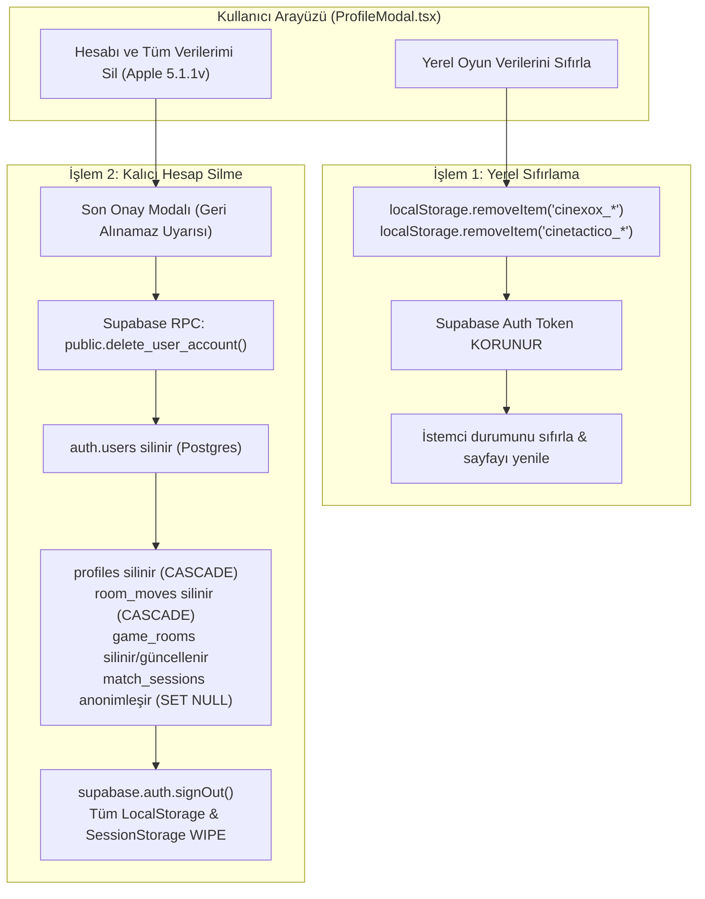

# CINE-XOX — GİZLİLİK VE HESAP SİLME UYGULAMA MİMARİSİ (FAZ 2A)
**Doküman:** `PRIVACY_ACCOUNT_DELETION_IMPLEMENTATION_PLAN.md`  
**Tarih:** 3 Kasım 2026  
**Durum:** Tasarım & Denetim (Uygulama Öncesi Onay Taslağı)  
**Hedef Platformlar:** Web (Vercel) & Mobil (iOS / Capacitor 8 / App Store)

---

## 1. GERÇEK VERİ AKIŞI VE SİSTEM ENVANTERİ

Projenin üretim kod tabanı (`src/backend/`, `src/features/`, `src/app/`, `supabase/migrations/`) satır satır taranmış ve toplanan/işlenen tüm veriler eksiksiz olarak haritalandırılmıştır:

### 1.1. Supabase Sunucu Tarafı Veri Akışı

| Tablo / Servis | Oluşturulma Anı & Yeri | Saklanan Alanlar | Kimlikle İlişki | Amacı | Silinme Zamanı | Diğer Kullanıcılar Görür mü? |
|---|---|---|---|---|---|---|
| **`auth.users`** (Supabase Auth) | İlk açılışta `src/backend/supabase/auth.ts` -> `ensureAnonymousSession()` çağrısıyla `signInAnonymously()` | `id` (UUID), `created_at`, `is_anonymous` (true), `raw_user_meta_data` | Anonim kullanıcı kimliği (PII içermez) | Oturum açma, RLS yetkilendirmesi, oda sahipliği | Normalde silinmez; hesap silme tetiklendiğinde silinir | **HAYIR** (Yalnızca auth servisi) |
| **`public.profiles`** | `auth.users` oluşturulduğunda DB Trigger (`handle_new_user()`) ile otomatik; `syncProfileToSupabase()` ile güncellenir | `id` (UUID, FK auth.users), `username`, `avatar_id`, `rank_title`, `rating`, `wins`, `losses`, `draws`, `streak`, `highest_combo`, `reels_balance`, `letterboxd_username`, `updated_at` | `auth.users(id)` ile 1:1 `ON DELETE CASCADE` | Profil kartı, lig derecesi, liderlik tablosu | Kullanıcı silindiğinde cascade ile silinir | **EVET** (Kullanıcı adı, avatar, unvan, rating ve lig sıralaması herkese açıktır) |
| **`public.game_rooms`** | Çok oyunculu Özel Gösterim oluşturulduğunda (`createRealtimeRoom`) | `id`, `room_code`, `host_id` (FK), `guest_id` (FK), `host_username`, `host_avatar`, `guest_username`, `guest_avatar`, `board_id`, `board_data`, `status`, `current_turn`, `winner`, `settings`, `created_at`, `updated_at` | `host_id` (`ON DELETE CASCADE`), `guest_id` (`ON DELETE SET NULL`) | 2 kişilik çok oyunculu eşleşme yönetimi | Oda terk edildiğinde veya maç bittiğinde kalır; temizlik cron'u yok | **EVET** (Oda kodunu bilen veya katılan oyuncu görür) |
| **`public.room_moves`** | Çok oyunculu odada hamle yapıldığında (`submit_move` RPC) | `id`, `room_code`, `player_id` (FK auth.users), `player_symbol`, `cell_index`, `movie_id`, `movie_data`, `is_stealing`, `move_number`, `created_at` | `player_id` (`ON DELETE CASCADE`) | Hamle sırası, kurallara uygunluk, senkronizasyon | Oyun bitiminde arşivlenir; odanın parçasıdır | **EVET** (Yalnızca aynı odadaki 2 oyuncu görür - RLS filtreli) |
| **`public.match_sessions`** | Çok oyunculu maç tamamlandığında (`archiveMatchSession`) | `id`, `room_code`, `player_x_id` (FK), `player_o_id` (FK), `winner_id` (FK), `outcome`, `game_mode`, `board_id`, `board_title`, `moves_count`, `score_rarity_x`, `score_rarity_o`, `total_arcade_score`, `final_cells`, `completed_at` | `player_x_id`, `player_o_id`, `winner_id` (`ON DELETE SET NULL`) | Geçmiş maç istatistikleri ve Letterboxd paylaşım kartı | Normalde silinmez (kalıcı arşiv) | **EVET** (Kamuya açık okunabilir - RLS `Public read`) |

### 1.2. RPC Fonksiyonları ve Tetikleyiciler (Triggers)
- **`public.handle_new_user()`:** `auth.users` üzerinde trigger. Rastgele `"Sinefil #XXXX"` kullanıcı adı ve başlangıç verisi üretir.
- **`public.change_username(new_username)`:** Benzersizlik kontrollü kullanıcı adı değiştirme RPC'si.
- **`public.submit_move(...)`:** Server-authoritative çok oyunculu hamle doğrulama ve tahta güncelleme RPC'si.
- **`public.set_current_timestamp_updated_at()`:** Zaman damgası güncelleyici.

### 1.3. Supabase Storage (Dosya/Görsel Havuzları)
- **Kullanım:** **YOK**. Projede herhangi bir dosya yükleme, avatar görseli veya poster depolama bucket'ı bulunmamaktadır. Tüm avatarlar kod tabanındaki SVG/vektör sabitleridir.

### 1.4. İstemci Tarafı Depolama (LocalStorage & SessionStorage)

| Anahtar (Key) | Nerede Tutulur? | Saklanan Veri | Amacı |
|---|---|---|---|
| `cinexox_player_profile` | `localStorage` | Oyuncu adı, avatar, offline galibiyet/mağlubiyet, makara bakiyesi, Letterboxd adı | Çevrimdışı ve hızlı açılış için yerel profil kopyası |
| `cinexox_match_history` | `localStorage` | Çevrimdışı bot maçları geçmişi (tarih, mod, rakip bot, skor, sonuç) | Son Maçlar modalında listeleme |
| `cinexox_last_streak_date` / `_utc` | `localStorage` | `YYYY-MM-DD` (UTC) | Günlük serinin (streak) aynı gün mükerrer artmasını önleme |
| `cinetactico_ambience_config` / `cinexox_ambience` | `localStorage` | Salon teması (Kadife, Analog vb.), karanlık/parıltı/gren değerleri | Yerel sinematik görsel tema tercihleri |
| `cinexox_ipucu_ters` / `cinexox_ipucu_konsept` | `localStorage` | `"görüldü"` | Mod tanıtım baloncuğunun tekrar tekrar açılmasını engelleme |
| `cinexox_guide_seen` | `localStorage` | `"görüldü"` | Oyun rehberinin (onboarding) her açılışta çıkmasını engelleme |
| `cinexox_haptic` | `localStorage` | `"1"` veya `"0"` | Titreşim (dokunsal geri bildirim) tercihi |
| `sb-<ref>-auth-token` | `localStorage` | Supabase Anonim JWT Access & Refresh Token | Supabase oturumunun sayfalar/seanslar arası kalıcılığı |
| `cinexox_splash_seen` | `sessionStorage` | `"1"` | Sayfa yenilemelerinde açılış logosunun seans boyunca tekrarlanmaması |
| `cinexox_opening_leak_shown` | `sessionStorage` | `"1"` | İlk açılış ışık sızması animasyonunun seans kontrolü |

### 1.5. Üçüncü Taraf SDK ve Ağ İstekleri
- **İzleme / Analitik / Crashlytics:** **SIFIR**. Sentry, Google Analytics, Firebase, Facebook SDK, Adjust vb. hiçbir takip kütüphanesi yüklü değildir.
- **Reklam Ağları:** **SIFIR**. AdMob, Unity Ads vb. hiçbir reklam SDK'sı yoktur.
- **Görsel / Medya CDN:** **SIFIR**. IMDb, TMDb veya harici poster CDN'lerine hiçbir istek atılmaz.
- **Yalnızca 2 Harici Ağ İstek Kaynağı Mevcuttur:**
  1. **Supabase API & Realtime WebSockets:** Yalnızca oyun verisi, oturum ve çok oyunculu maçlar için (`NEXT_PUBLIC_SUPABASE_URL`).
  2. **Google Fonts (Web):** `fonts.googleapis.com` (Barlow Condensed, Inter, Newsreader fontları için CSS CDN).

---

## 2. MEVCUT GİZLİLİK POLİTİKASI HATALARI VE GEREKLİ DÜZELTMELER

[`src/app/privacy/page.tsx`](file:///Users/efe/Desktop/untitled%20folder/FI%CC%87LMSEL/src/app/privacy/page.tsx) dosyasındaki ifadeler kod gerçekliğiyle karşılaştırıldığında aşağıdaki 4 temel hata tespit edilmiştir:

| Mevcut Metin (Hatalı/Eksik) | Kod Gerçekliği | Düzeltme Stratejisi |
|---|---|---|
| *"HİÇBİR kişisel veri... toplamaz, işlemez ve sunuculara göndermez."* | Anonim UUID (`auth.users`), oyuncu adı, kazanma/kaybetme ve çok oyunculu hamle verileri Supabase sunucularına iletilmektedir. | Verilerin doğrudan kişiyi teşhis edici (ad, tel, e-posta) olmadığı, ancak oturum ve oyun ilerlemesi için **anonim takma ad ve rastgele kullanıcı kimliği (UUID)** tutulduğu açıkça yazılmalıdır. |
| *"Oyun sırasında harici sunuculara hiçbir ağ isteği gönderilmez. Uygulama internet bağlantısı olmaksızın tamamen çevrimdışı oynanabilir."* | Bot modu çevrimdışı çalışabilse de, Çevrimiçi Özel Gösterim, Liderlik Tablosu ve Oturum Senkronizasyonu Supabase sunucusuna ağ istekleri gönderir. | Tek kişilik oyunun çevrimdışı oynanabildiği; ancak çok oyunculu modlar ve sıralama tablosu için Supabase bulut altyapısına güvenli WebSocket ve HTTPS istekleri yapıldığı netleştirilmelidir. |
| *"Kullanıcının tercih ettiği salon teması ve ışık ayarları..."* | "Salon Işığı" bir pazarlama terimidir ve oyunda salon ambiyans ayarları (`cinetactico_ambience_config`) dışında harici bir "ışık ayarı" yoktur. | İfade "yerel görsel tema ve salon ambiyansı tercihleri" olarak düzeltilmelidir. |
| *"Kullanıcı dilediği an uygulama içindeki profil menüsünden 'Yerel Oyun Verilerini Sıfırla' seçeneği ile bu tercihleri silebilir."* | Profil modalında böyle bir buton henüz **YOKTUR**. | Bu buton Bölüm 4'teki tasarıma uygun olarak profile eklenecek ve metinle senkronize edilecektir. |

---

## 3. APPLE APP STORE GEREKLİLİKLERİ (GUIDELINE 5.1.1(v) & APP PRIVACY)

### 3.1. Apple Guideline 5.1.1(v) — Otomatik Misafir Hesap Silme Kuralı
Apple'ın zorunlu yönergesine göre:
> *"Uygulamanız hesap oluşturmayı destekliyorsa (arka planda otomatik oluşturulan misafir/anonim sunucu hesapları dahil), kullanıcının uygulamanın içinden hesabını tamamen silebilmesini sağlamalısınız."*

**Gereksinimler:**
1. Hesap silme seçeneği kolayca bulunabilir olmalıdır (Profil -> Ayarlar veya Tehlikeli Bölge).
2. Yalnızca oturumu kapatmak (sign-out) veya yerel veriyi silmek yeterli değildir; **sunucudaki kullanıcı kaydı (`auth.users`) kalıcı olarak silinmelidir**.
3. Kullanıcıya işlemin kalıcı olduğu bildirilmeli ve açık bir onay (confirmation dialog) alınmalıdır.
4. Başka oyuncuların maç arşivleri bozulmamalıdır. CINE-XOX'un mevcut `match_sessions` tablosundaki `ON DELETE SET NULL` kuralı bu şartı mükemmel şekilde sağlamaktadır.

### 3.2. Apple App Privacy Formu Sınıflandırması (App Store Connect)

| Veri Kategorisi | Toplanıyor mu? | Toplama Amacı | Kullanıcı Kimliğiyle İlişkilendiriliyor mu? | Takip (Tracking) Amacı Var mı? |
|---|---|---|---|---|
| **User ID** | **EVET** | **App Functionality** (Oyun oturumu, puanlar, çok oyunculu eşleşme) | **HAYIR** (Not linked to user identity — rastgele üretilen anonim UUID) | **HAYIR** |
| **Gameplay Content** | **EVET** | **App Functionality** (Maç geçmişi, yapılan hamleler, zafer/yenilgi oranları) | **HAYIR** (Not linked to user identity) | **HAYIR** |
| **Device ID** | **HAYIR** | — | — | — |
| **Product Interaction** | **HAYIR** | — | — | — |
| **Diagnostics** | **HAYIR** | — | — | — |
| **Crash Data** | **HAYIR** | — | — | — |
| **Performance Data** | **HAYIR** | — | — | — |
| **Other User Content** | **HAYIR*** | Kullanıcının girdiği isteğe bağlı Letterboxd takma adı | **HAYIR** (Profilde yerel/isteğe bağlı) | **HAYIR** |

> [!IMPORTANT]
> Apple App Store Connect'te **"Data Not Collected" SEÇİLEMEZ**. Doğru beyan: *"Veri toplanmaktadır ancak kullanıcının gerçek kimliğiyle ilişkilendirilmemektedir (Data Not Linked to You)"* ve *"Takip amacıyla kullanılmamaktadır (Not used for tracking)"*.

---

## 4. İKİ FARKLI SİLME İŞLEMİNİN MİMARİSİ

Kullanıcının yerel önbelleğini temizlemesi ile sunucudaki hesabını tamamen yok etmesi arasındaki ayrım netleştirilmiştir:



### 4.1. İşlem 1: Yerel Oyun Verilerini Sıfırla (Local Reset)
- **Amaç:** Cihazdaki bozulmuş önbelleği, yerel maç geçmişini ve offline tercihleri temizlemek.
- **Kapsam:**
  - `localStorage.removeItem("cinexox_player_profile")`
  - `localStorage.removeItem("cinexox_match_history")`
  - `localStorage.removeItem("cinexox_last_streak_date")`
  - `localStorage.removeItem("cinexox_last_streak_utc")`
  - `localStorage.removeItem("cinetactico_ambience_config")`
  - `localStorage.removeItem("cinexox_ambience")`
  - `localStorage.removeItem("cinexox_ipucu_ters")`
  - `localStorage.removeItem("cinexox_ipucu_konsept")`
  - `localStorage.removeItem("cinexox_guide_seen")`
- **KORUNAN ALANLAR:**
  - `sb-<ref>-auth-token` **silinmez**. Kullanıcı Supabase hesabını ve lig derecesini kaybetmez; sunucudan profili yeniden çekilir.
- **Arayüz Uyarısı:**
  > *"Bu işlem cihazınızda kayıtlı çevrimdışı maç geçmişini ve tema tercihlerinizi sıfırlar. Çevrimiçi lig dereceniz ve profiliniz korunur."*

### 4.2. İşlem 2: Hesabı ve Tüm Verilerimi Sil (Permanent Account Deletion)
- **Amaç:** Apple Guideline 5.1.1(v) ve GDPR/KVKK uyumu. Kullanıcının sunucudaki tüm varlığını silmek.
- **Güvenlik Zorunluluğu:**
  - İstemcide asla `SUPABASE_SERVICE_ROLE_KEY` bulunamaz.
  - İstemci `auth.users` tablosuna doğrudan `DELETE` atamaz.
  - Mevcut RLS politikalarında `DELETE` izni kapalıdır.
- **Çözüm: `public.delete_user_account()` RPC Fonksiyonu (PostgreSQL `SECURITY DEFINER`)**

#### Tasarlanan PostgreSQL Fonksiyonu:
```sql
create or replace function public.delete_user_account()
returns jsonb
language plpgsql
security definer
set search_path = public, auth
as $$
declare
  v_user_id uuid;
begin
  -- 1. Oturum açmış kullanıcının kimliğini doğrula
  v_user_id := auth.uid();
  if v_user_id is null then
    return jsonb_build_object('success', false, 'error', 'Yetkisiz erişim. Oturum bulunamadı.');
  end if;

  -- 2. Bekleyen veya terk edilmiş odalarını temizle
  delete from public.game_rooms
  where host_id = v_user_id and status in ('WAITING', 'ABANDONED');

  -- 3. Devam eden oda varsa hükmen terk et (rakibin oyunu kilitlenmesin)
  update public.game_rooms
  set status = 'ABANDONED',
      winner = case when host_id = v_user_id then 'O' else 'X' end
  where (host_id = v_user_id or guest_id = v_user_id) and status = 'IN_PROGRESS';

  -- 4. auth.users kaydını sil
  -- CASCADE tetiklenir: public.profiles silinir, public.room_moves silinir.
  -- SET NULL tetiklenir: public.match_sessions (rakibin geçmişi bozulmaz, kimlik null olur).
  delete from auth.users where id = v_user_id;

  return jsonb_build_object('success', true);
exception
  when others then
    return jsonb_build_object('success', false, 'error', SQLERRM);
end;
$$;

-- Yalnızca kimliği doğrulanmış kullanıcılar kendi adına çağırabilir
revoke execute on function public.delete_user_account() from public, anon;
grant execute on function public.delete_user_account() to authenticated;
```

#### İstemci Tarafı İcra Adımları:
1. Kullanıcı Profile Modal -> "Hesabı Sil" seçeneğine tıklar.
2. Açılan kırmızı onay modalında: *"Hesabınızı sildiğinizde unvanınız, lig dereceniz, makara bakiyeniz ve tüm maç verileriniz kalıcı olarak silinir. Bu işlem geri alınamaz."* uyarısı gösterilir.
3. Kullanıcı "Hesabımı Kalıcı Olarak Sil" onayını verir.
4. İstemci `supabase.rpc("delete_user_account")` çağrısını yapar.
5. Başarılı yanıt geldiğinde:
   - `await supabase.auth.signOut()` çalıştırılır.
   - İstemcideki tüm `localStorage` (`cinexox_*`, `cinetactico_*`, `sb-*`) ve `sessionStorage` anahtarları tamamen temizlenir (`clear()`).
   - Kullanıcı bilgilendirme mesajıyla ana sayfaya yönlendirilir (`window.location.href = "/"`).

---

## 5. DÜZELTİLMİŞ GİZLİLİK POLİTİKASI METİN TASLAĞI (TR & EN)

### 5.1. Türkçe Metin Taslağı (Turkish Draft)

```markdown
# Gizlilik Politikası (Privacy Policy)
Son Güncelleme: 3 Kasım 2026

CINE-XOX ("Uygulama"), sinemaseverler için geliştirilmiş taktiksel bir XOX oyunudur. Bu gizlilik politikası, uygulamamızı kullandığınızda verilerinizin nasıl işlendiğini, saklandığını ve korunduğunu açıklar.

### 1. Toplanan Veriler ve Kullanım Amaçları
CINE-XOX, kullanıcılarından ad, soyad, e-posta, telefon numarası, coğrafi konum veya cihaz seri numarası gibi doğrudan kimlik belirten hiçbir kişisel veri toplamaz.

Oyun deneyimini sağlamak için yalnızca şu veriler işlenir:
- **Anonim Oyuncu Kimliği:** Uygulama ilk açıldığında sunucu tarafında rastgele bir kullanıcı kimliği (UUID) oluşturulur. Bu kimlik herhangi bir kişisel veriyle ilişkilendirilmez.
- **Oyun İlerlemesi ve İstatistikler:** Lig dereceniz (rating), kazandığınız unvanlar, galibiyet/mağlubiyet sayılarınız ve makara (reels) bakiyeniz.
- **Çok Oyunculu Maç Kayıtları:** Çevrimiçi Özel Gösterim odalarında yapılan tahta hamleleri ve tamamlanan maçların sonuçları.
- **İsteğe Bağlı Bilgiler:** Profilinizde görüntülenmek üzere kendi seçtiğiniz takma ad (username), avatar ve isteğe bağlı Letterboxd kullanıcı adı.

### 2. Çevrimdışı ve Çevrimiçi Modlar
- **Tek Kişilik Oyun (Bot Karşılaşmaları):** İnternet bağlantısı gerektirmez. Maç geçmişiniz ve ayarlarınız yalnızca cihazınızın yerel belleğinde (localStorage) saklanır.
- **Çok Oyunculu Mod ve Sıralama:** Çevrimiçi maç senkronizasyonu ve genel lig tablosu için güvenli bulut sağlayıcımız Supabase altyapısına şifreli (HTTPS/WSS) ağ istekleri yapılır.

### 3. Üçüncü Taraf Hizmetler ve Reklamlar
- Uygulamamızda üçüncü taraf reklam ağları (AdMob vb.) yer almaz.
- Kullanıcı davranışlarını takip eden üçüncü taraf analitik veya izleme (tracking) araçları kullanılmaz.
- Verileriniz hiçbir reklamveren veya veri simsarıyla paylaşılmaz ya da satılmaz.
- Bulut veri tabanı altyapısı Supabase Inc. tarafından yüksek güvenlik standartlarıyla sağlanmaktadır.

### 4. Veri Saklama ve Silme Hakları (Apple 5.1.1(v) & KVKK/GDPR)
Kullanıcılarımız verileri üzerinde tam kontrole sahiptir:
- **Yerel Verileri Sıfırlama:** Profil menüsünden "Yerel Verileri Sıfırla" seçeneğini kullanarak cihazınızdaki önbelleği, çevrimdışı maç geçmişini ve tema tercihlerini silebilirsiniz.
- **Hesabı ve Tüm Verileri Silme:** Profil menüsündeki "Hesabı ve Verilerimi Sil" seçeneğini kullanarak sunucumuzda kayıtlı anonim profilinizi, lig derecenizi ve istatistiklerinizi kalıcı olarak silebilirsiniz. Silinen veriler geri getirilemez.

### 5. İletişim
Gizlilik politikamız veya veri haklarınızla ilgili her türlü soru için:
**Geliştirici:** Efe Öztürkan  
**E-posta:** efezturkan@gmail.com
```

### 5.2. İngilizce Metin Taslağı (English Draft)

```markdown
# Privacy Policy
Last Updated: November 3, 2026

CINE-XOX ("the App") is a tactical cinema duel game. This Privacy Policy outlines how your data is handled, stored, and protected when you use our application.

### 1. Data Collection and Purpose
CINE-XOX does NOT collect personally identifiable information such as your real name, email address, phone number, GPS location, or persistent device hardware identifiers.

To provide core game functionality, the following data is processed:
- **Anonymous Player ID:** Upon first launch, a randomized pseudonymous user identifier (UUID) is generated. This ID is never linked to your real identity.
- **Gameplay Progress & Stats:** Tier rating, rank titles, wins, losses, draws, and reels balance.
- **Multiplayer Match Data:** Turn moves and match outcomes in Custom Room multiplayer duels.
- **Optional Profile Content:** A chosen public display nickname, avatar selection, and optional Letterboxd handle.

### 2. Offline vs. Online Modes
- **Single-Player (Bot Matches):** Fully functional offline. Game history and display preferences are stored locally on your device (localStorage).
- **Online Multiplayer & Leaderboards:** Secure encrypted network connections (HTTPS/WSS) to our cloud service provider, Supabase, are utilized for realtime gameplay and global rankings.

### 3. Third Parties and Advertising
- The App contains NO third-party advertising networks.
- The App contains NO third-party behavioural analytics or tracking SDKs.
- Your gameplay data is never sold or shared with data brokers.
- Cloud database services are powered by Supabase Inc. under strict security standards.

### 4. Data Retention & Deletion Rights (Apple Guideline 5.1.1(v) & GDPR)
You maintain full autonomy over your data:
- **Reset Local Data:** Clears local device cache, offline bot matches, and visual theme preferences without altering your online standing.
- **Delete Account & All Data:** Located within the Profile menu, "Delete Account" permanently purges your server-side record, stats, rating, and anonymous ID. This action is irreversible.

### 5. Contact Information
For questions regarding this policy or data inquiries:
**Developer:** Efe Öztürkan  
**Email:** efezturkan@gmail.com
```

> [!NOTE]
> *Hukuki Uyarı Notu:* Bu metin teknik veri mimarisine ve Apple App Store yönergelerine birebir uygun olarak hazırlanmış teknik bir taslaktır. Mağaza yayını öncesinde genel hukuk ve tüketici mevzuatı kapsamında gözden geçirilmesi önerilir.

---

## 6. GEREKLİ DOSYALAR VE UYGULAMA DEĞİŞİKLİKLERİ

| Dosya | Değişiklik Amacı |
|---|---|
| `supabase/migrations/20261103_faz5_account_deletion_rpc.sql` | `public.delete_user_account()` RPC fonksiyonunu tanımlayan güvenli migration. |
| `src/backend/supabase/auth.ts` | `deleteUserAccount(): Promise<{success: boolean; error?: string}>` istemci sarmalayıcısının eklenmesi. |
| `src/features/profile/components/ProfileModal.tsx` | "Yerel Verileri Sıfırla" ve "Hesabımı ve Verilerimi Sil" butonları ve onay pencerelerinin eklenmesi. |
| `src/app/privacy/page.tsx` | Gerçekçi ve dürüst TR/EN gizlilik politikasının yerleştirilmesi. |
| `src/tests/auth-identity.test.ts` | Hesap silme akışını ve yerel sıfırlamayı doğrulayan birim test senaryoları. |

---

## 7. RİSK ANALİZİ VE GERİ DÖNÜŞ (ROLLBACK) PLANI

1. **Risk: Silme İşleminin Yarıda Kalması (Network Drop):**
   - *Önlem:* RPC tek bir PostgreSQL fonksiyonu içinde atomik transaction olarak çalışır. `auth.users` silinemezse tüm işlem `ROLLBACK` olur. Veritabanında yetim (orphan) kayıt kalmaz.
2. **Risk: Çok Oyunculu Maçta Oynayan Rakibin Kilitlenmesi:**
   - *Önlem:* `delete_user_account()` RPC'si, kullanıcının o an oynadığı bir maç varsa odayı `ABANDONED` yapar ve rakibi otomatik galip ilan eder. Rakibin ekranı donmaz.
3. **Risk: Yanlışlıkla Hesap Silme:**
   - *Önlem:* Tek tıklamayla silme yapılamaz. Çift aşamalı, kırmızı zeminli, açık uyarı metni içeren bir modal onay mekanizması tasarlanmıştır.
4. **Geri Dönüş Planı:**
   - Değişiklikler yalnızca yeni bir RPC ve profil modalında iki yeni buton ile sınırlıdır. Oyun motoru (`src/core/engine`) veya mevcut multiplayer protokolü etkilenmez. Herhangi bir sorunda migration `down.sql` ile geri alınabilir.

---

## 8. UYGULAMA SIRASI VE EFOR TAHMİNİ

1. **Adım 1:** `supabase/migrations/20261103_faz5_account_deletion_rpc.sql` migration dosyasının oluşturulması.
2. **Adım 2:** `src/backend/supabase/auth.ts` içine `deleteUserAccount` fonksiyonunun eklenmesi.
3. **Adım 3:** `ProfileModal.tsx` içine "Veri Yönetimi & Gizlilik" sekmesi / tehlikeli bölge (Danger Zone) arayüzünün entegre edilmesi.
4. **Adım 4:** `src/app/privacy/page.tsx` sayfasının güncellenmesi.
5. **Adım 5:** Testlerin (`npm test`, `npx tsc --noEmit`) koşulması ve doğrulanması.

*Tahmini Uygulama Süresi:* 1 Tur (Tek cerrahi müdahale paketi).

---
**ÖZET:** Tasarım planı tamamlanmış olup hiçbir kaynak koda dokunulmamıştır. Kullanıcıdan uygulama onayı beklenmektedir.
