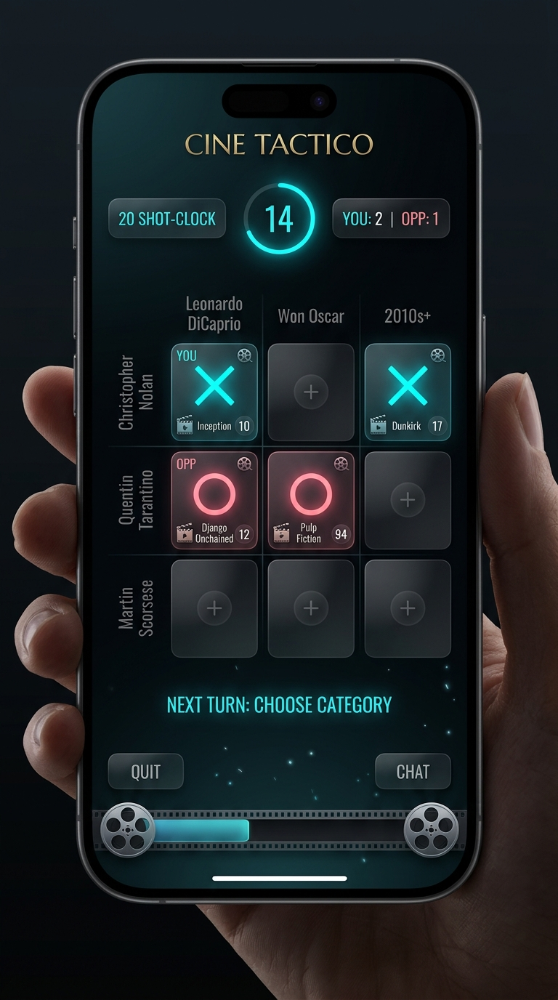

# 🎬 CINE-XOX (FİLMSEL)

> **Sinema Kültürü ve Taktiksel XOX Düellosu (Web & Mobile Native)**  
> Next.js 14, React 18, Tailwind CSS, TypeScript, Capacitor (iOS & Android) ve Supabase Realtime ile geliştirilmiş 3x3 sinefil strateji oyunu.

[](https://github.com/efezturkan/cine-tactico/actions/workflows/ci.yml)
[](https://www.typescriptlang.org/)
[](https://nextjs.org/)
[](https://capacitorjs.com/)
[](https://supabase.com/)
[](https://opensource.org/licenses/MIT)

<p align="center">
  
</p>

---

### 🎯 Nasıl Oynanır? (10 Saniyede Özet)
1. **Matrisi İncele**: 3x3 tahtanın her satır ve sütununda bir sinema kriteri bulunur (Örn: *Yönetmen: Christopher Nolan* × *Aktör: Leonardo DiCaprio*).
2. **Kesişimi Bul**: 12 saniyelik Blitz süresi bitmeden iki kritere de uyan filmi (*Inception*) yaz.
3. **Kareyi Mühürle & Kazan**: Doğru film kareyi kilitler. Klasik XOX gibi yatay, dikey veya çapraz **3'lü hat kuran maçı kazanır!**

---

## 🏛️ Mimari Katmanlar

Proje; temiz kod prensiplerine, katman ayrımına (Layered Clean Architecture) ve hem insan hem de yapay zeka coding agent'larının kolayca çalışabileceği tek sorumluluk ilkesine göre yapılandırılmıştır:

```text
CINE-XOX/
│
├── src/
│   ├── core/                      # 🧠 BAĞIMSIZ OYUN MOTORU (Pure TS, Sıfır UI/DB bağımlılığı)
│   │   ├── engine/                # rules.ts, validator.ts, bot-ai.ts, board-generator.ts
│   │   ├── types/                 # Temel oyun veri tipleri
│   │   └── index.ts
│   │
│   ├── data/                      # 🍿 OYUN İÇERİK VERİTABANLARI
│   │   ├── movies.ts              # Provenance & Wikidata doğrulanmış film arşivi
│   │   ├── boards.ts              # 13+ tematik tahta ve bot rakipler
│   │   └── actors.ts              # Takma ad ve alternatif isim tolerans kataloğu
│   │
│   ├── backend/                   # ☁️ BACKEND & ERİŞİM KATMANI
│   │   ├── supabase/              # client.ts (Güvenli istemci), types.ts (DB DTO'ları)
│   │   └── repositories/          # rooms.ts, matches.ts, profiles.ts, leaderboard.ts
│   │
│   ├── features/                  # 🎮 ÖZELLİK KATMANLARI (Modüler & Domain-driven)
│   │   ├── gameplay/              # useGameSession hook'u, GameView ve oyun içi bileşenler
│   │   ├── multiplayer/           # useRealtimeMatch hook'u ve oda modalları
│   │   └── profile/               # Profil, Leaderboard, Savaş Geçmişi ve Dükkan modalları
│   │
│   ├── components/                # 🧩 ORTAK UI BİLEŞENLERİ (HomeScreen, GameSelectScreen, Header, GlobalModals)
│   ├── utils/                     # 🔊 Ses (Web Audio) ve Dokunsal Geri Bildirim (Capacitor Haptics)
│   └── app/                       # 🌐 Next.js App Router (page.tsx - ince görünüm koordinatörü)
│
├── supabase/                      # 🗄️ SUPABASE YAPILANDIRMASI
│   ├── schema.sql                 # Veritabanı tabloları ve Realtime yayını
│   └── migrations/                # Güvenlik ve RLS sertleştirme script'leri
│
├── ios/ & android/                # 📱 CAPACITOR NATIVE PROJELERİ
├── capacitor.config.ts            # Mobil paketleme konfigürasyonu
└── next.config.js                 # output: "export" statik derleme ayarı
```

---

## ⚡ Temel Özellikler

1. **Oyun Modları**:
   - **Klasik Düello (3x3)**: Yönetmen × Oyuncu, Tür × Dönem gibi kriterlerin kesişimine doğru filmi yerleştirerek 3'lü hat kurma.
   - **Ters Kadraj (Ortak Oyuncu)**: İki filmin kesişimindeki ortak aktörü bularak en çok kareyi mühürleme.
   - **Sinefil Konsept & Kült Arenası**: Plot twist, distopya, tek mekan gibi tematik zorluklar.
   - **Bot AI (Yapay Zeka)**: Kolay, Orta ve Usta seviyelerinde organik düşünme süreleri (`getBotThinkingDelay`) ve taktiksel bloklama/kazanma motoru.
   - **Online 1v1 Multiplayer**: Supabase Realtime Broadcast & Presence üzerinden oda kodlu canlı düello.
2. **Anti-Cheat & Eksen Güvenliği**:
   - 12 saniyelik Blitz Shot-Clock ile dış kaynak aramasını önleme.
   - Arama pencerelerinde en az 2 karakter zorunluluğu; tür veya yıl bazlı film listelemeyi engelleyen metadata sızıntı koruması.
   - Her tahtanın tüm 9 hücresinde en az 3 geçerli film/aktör bulunmasını garanti eden matematiksel çözülebilirlik kuralı.
3. **Cross-Platform Native (Capacitor)**:
   - Next.js statik çıktısı (`./out`), iOS ve Android yerel webview'larına gömülerek sıfır gecikmeli çevrimdışı çalışma ve native dokunsal titreşim (`@capacitor/haptics`) sunar.

---

## 🛠️ Kurulum ve Geliştirme

### Gereksinimler
- Node.js 18+ (Önerilen: v20 LTS)
- npm 9+

### Adımlar
```bash
# 1. Bağımlılıkları yükleyin
npm install

# 2. Ortam değişkenlerini hazırlayın
cp .env.example .env.local
# .env.local dosyasındaki Supabase URL ve Anon Key'i doldurun

# 3. Geliştirme sunucusunu başlatın
npm run dev

# 4. Birim ve Güvenlik Testlerini Çalıştırın (59/59 Test)
npm test

# 5. TypeScript tip denetimini yapın
npx tsc --noEmit

# 6. Mobil ve prodüksiyon için statik derleme alın
npm run build
```

---

## 📱 Mobil Derleme (iOS & Android)

```bash
# Next.js statik çıktısını oluşturun ve Capacitor native projeleriyle senkronize edin
npm run build
npx cap sync

# iOS Xcode projesini açın
npx cap open ios

# Android Studio projesini açın
npx cap open android
```

---

## 🧪 Test Kapsamı (59/59 Test %100 Başarı)

Test paketi `npm test` komutuyla 3 bağımsız suiti tek seferde doğrular:
1. **Oyun Motoru & Bot AI (38 Test)**: 8 kazanma kombinasyonu, 13 hazır tahta çözülebilirliği, bot taktiksel karar motoru, mühürlü hücreler ve Levenshtein aktör toleransı.
2. **Anti-Cheat & Arama Sızıntı Koruması (11 Test)**: Minimum karakter kuralları ve tür/yıl/yönetmen bazlı film listelemeyi engelleyen metadata koruması.
3. **SSR Modal HTML Güvenlik Denetimi (10 Test)**: Arama kartlarında adil oyunu bozacak ipuçlarının (tür, yıl, Oscar, gişe) DOM'a asla sızmadığının sunucu tarafı render doğrulaması.

---

## 📄 Lisans

Bu proje [MIT Lisansı](LICENSE) altında lisanslanmıştır. © 2026 Efe Öztürkan.
