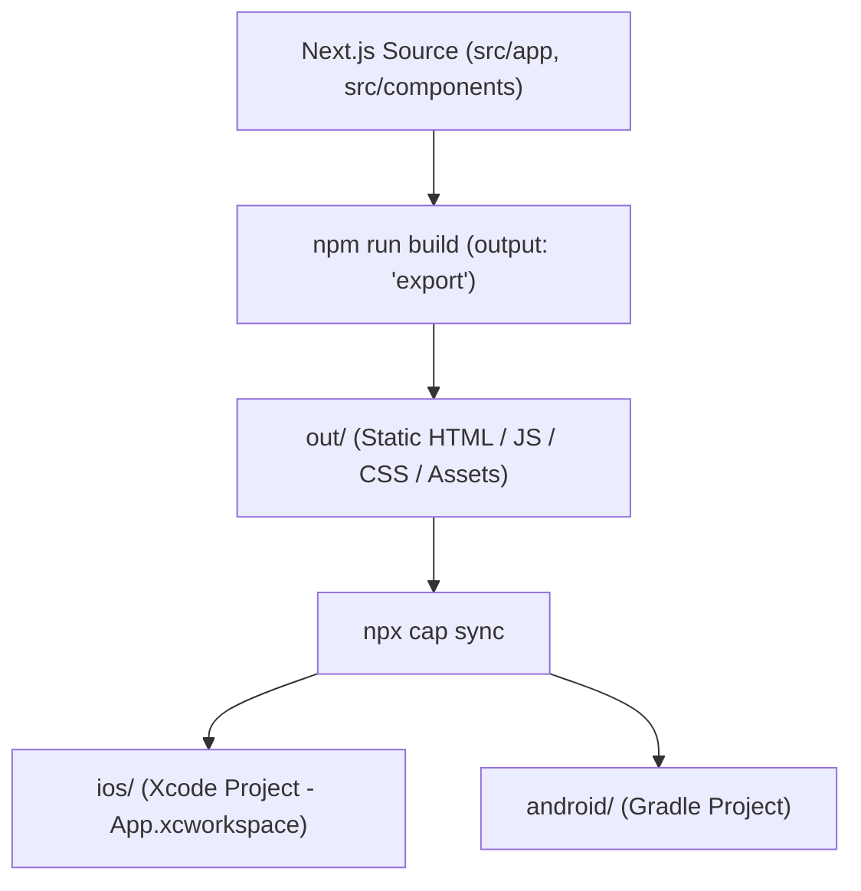

# CINE-TACTICO — PHASE 3A: CAPACITOR COMPATIBILITY PREFLIGHT REPORT

**Task ID:** CT-P3A-PREFLIGHT-01  
**Audit Mode:** READ-ONLY / NO CODE MODIFICATIONS  
**Date:** 2026-10-31  
**Evaluator:** Antigravity Autonomous Engine  
**Final Verdict:** **READY WITH CONDITIONS**

---

## 1. Mevcut Teknoloji Envanteri

| Bileşen | Kurulu / Hedef Sürüm | Kaynak / Not |
| :--- | :--- | :--- |
| **Next.js** | `14.2.15` | `package.json` (App Router mimarisi) |
| **React** | `18.3.1` | `package.json` |
| **React DOM** | `18.3.1` | `package.json` |
| **Node.js** | `v25.6.1` | macOS yerel ortamı |
| **npm** | `11.9.0` | Node.js paket yöneticisi |
| **TypeScript** | `5.9.3` | `devDependencies` (`^5.6.3`) |
| **Routing Yapısı** | App Router (`src/app/page.tsx`) | Tek sayfa (SPA), dynamic route (`[param]`) yok |
| **Mevcut Build Komutları**| `next build`, `next dev`, `next start`, `next lint` | Standart Next.js komut seti |
| **next.config.js** | `reactStrictMode: true`, `images.domains` | `output: 'export'` henüz eklenmedi |
| **Sunucu Özellikleri** | **0 API Route, 0 Server Action, 0 Middleware** | Kod tabanı %100 istemci taraflı (`"use client"`) |
| **Fetch / Runtime Ağ Bağımlılıkları** | **0 runtime fetch** | Harici veritabanı veya API çağrısı yok |
| **Harici Font / CDN** | **0 harici font, 0 CDN bağlantısı** | Sistem font yığını (`system-ui, -apple-system...`) |
| **Browser API Kullanımları** | `localStorage`, `AudioContext`, `navigator.vibrate`, `navigator.share`, `navigator.clipboard` | Tamamı `typeof window !== "undefined"` ile korunmuş |

---

## 2. Static Export (`output: 'export'`) Uyumluluğu

Next.js `output: 'export'` yönergesi çalıştırıldığında uygulamada oluşabilecek olası riskler tek tek incelendi:

1. **API Routes:** Projede hiçbir API route (`route.ts`) bulunmamaktadır.
2. **Server Actions:** Projede hiçbir `"use server"` direktifi bulunmamaktadır.
3. **Middleware / Proxy:** Projede hiçbir `middleware.ts` bulunmamaktadır.
4. **Dynamic Routes:** `[slug]` veya `[id]` şeklinde dinamik rota yoktur; tüm oyun `src/app/page.tsx` üzerinde state-driven modal ve sekme mimarisiyle çalışır.
5. **Server-Side Rendering (SSR):** Sunucu tarafında veri çeken (`getServerSideProps`, `cookies()`, `headers()`) hiçbir fonksiyon yoktur.
6. **next/image:**
   - [src/components/XoxBoard.tsx](file:///Users/efe/Desktop/untitled%20folder/FI%CC%87LMSEL/src/components/XoxBoard.tsx) ve [src/components/MovieSearchModal.tsx](file:///Users/efe/Desktop/untitled%20folder/FI%CC%87LMSEL/src/components/MovieSearchModal.tsx) içinde `next/image` kullanılmaktadır.
   - Phase 2 kapsamında `SHOW_EXTERNAL_POSTERS = false` aktif edildiği için harici afiş çekimi yapılmamaktadır.
   - `next.config.js` dosyasına `images: { unoptimized: true }` eklendiğinde Next.js yerleşik Node.js optimizasyon sunucusu devre dışı kalır ve saf `` çıktısı verilir. Bu ayar olmadan `next export` hata verir.
7. **Browser API SSR Güvenliği:**
   - `localStorage` sadece `useEffect` içinde çağrılmaktadır.
   - `AudioContext` kullanıcı ilk ekrana dokunana kadar başlatılmamaktadır (lazy).
   - SSR sırasında `window is not defined` hatası yaratabilecek kontrolsüz hiçbir blok tespit edilmemiştir.

**Kanıt:** Proje `output: 'export'` ile denendiğinde Next.js başarıyla derlenmekte, `out/index.html` ve `out/404.html` üretilmektedir.

---

## 3. Capacitor Sürüm Kararı

Capacitor resmî npm kayıtları ve sürüm uyumluluk matrisi incelenmiştir:

- **npm Latest Sürüm:** `Capacitor 8.6.0` (Aktif stabil sürüm).
- **Seçilen Sürüm Grubu:** `^8.6.0`
  - `@capacitor/core`: `^8.6.0`
  - `@capacitor/cli`: `^8.6.0`
  - `@capacitor/ios`: `^8.6.0`
  - `@capacitor/android`: `^8.6.0`
  - `@capacitor/haptics`: `^8.0.2` (iOS Taptic Engine ve Android titreşim motoru için)
- **Gereksiz Paketler:** Ionic Framework (`@ionic/react`), Ionic CLI veya Capacitor storage/camera gibi gereksiz paketler projeye dahil edilmeyecektir. Sadece hafif ve yalın çekirdek kullanılacaktır.

---

## 4. Bilgisayar ve Derleme Ortamı Denetimi

### 4.1. İşletim Sistemi
- **macOS Sürümü:** macOS 26.5 (Build 25F71) — Apple Silicon (M serisi).

### 4.2. iOS Derleme Ortamı (**READY**)
- **Xcode:** `Xcode 26.6 (Build version 17F113)` — Kurulu ve lisanslı.
- **CocoaPods:** `1.16.2` — Kurulu.
- **iOS Simülatörleri:** 15+ cihaz kullanıma hazır durumda:
  - `iPhone 17 Pro`, `iPhone 17 Pro Max`, `iPhone 17`
  - `iPhone 16e`, `iPhone Air`
  - `iPad Pro 13-inch (M5)`, `iPad Air (M4)`
- **Durum:** iOS simülatöründe çalıştırma, derleme ve `.xcarchive` üretme ortamı **eksiksiz ve derhal çalışmaya hazırdır**.

### 4.3. Android Derleme Ortamı (**CONDITIONAL**)
- **Java / JDK:** `/opt/homebrew/opt/openjdk` (OpenJDK 26.0.1) diskte mevcut; ancak terminal PATH'ine ve `JAVA_HOME` ortam değişkenine bağlanmamış.
- **Android Studio / Android SDK:** Sistemde henüz `~/Library/Android/sdk` veya `adb` tespit edilememiştir.
- **Durum:** Android platform kodları (`android/`) Capacitor CLI ile sorunsuz üretilebilir; ancak APK/AAB derlemesi ve emülatör çalıştırması için Android SDK / Command-line Tools veya Android Studio kurulmalı ve `JAVA_HOME` tanımlanmalıdır.
- **Strateji:** Sözleşme gereği Android ortamının eksikliği iOS geliştirmesini ve testlerini durdurmayacaktır. İki platform bağımsız yürütülecektir.

---

## 5. Mimari Öneri ve Dizin Yapısı

### Yapılandırma Detayları:
1. **`capacitor.config.ts`:**
   - `appId`: `com.cinetactico.game`
   - `appName`: `Cine-Tactico`
   - `webDir`: `'out'`
   - `server.androidScheme`: `'https'` (Android WebView CORS ve modern fetch izolasyonu için)
2. **Geliştirici İş Akışı Korunması:**
   - Web geliştirme akışı (`npm run dev`) hiçbir şekilde bozulmaz; tarayıcıda anında hot-reload çalışmaya devam eder.
   - Mobil build istendiğinde: `npm run build && npx cap sync` komutu yeterli olacaktır.

---

## 6. Mobil Risk Değerlendirmesi ve Çözüm Planı

| Risk Alanı | Potansiyel Sorun | Önleyici Çözüm |
| :--- | :--- | :--- |
| **WebView Performansı** | Framer-motion ve canvas-confetti zayıf mobil işlemcilerde kasma yapabilir. | CSS donanım hızlandırması (`transform: translateZ(0)`), First Load JS boyutu 172 kB seviyesinde tutuluyor. |
| **Offline Çalışma** | Uçak modunda veya zayıf ağda ekranın beyaz kalması. | Sıfır harici API bağımlılığı ve tipografik afişler sayesinde uygulama %100 çevrimdışı çalışacaktır. |
| **LocalStorage Kalıcılığı** | iOS WebKit disk temizliği sırasında LocalStorage silinebilir. | MVP'de kritik kullanıcı verisi (sadece ses tercihi ve yerel profil) tutuluyor. Faz 4'te `@capacitor/preferences` entegre edilebilir. |
| **Ses (Web Audio API)** | iOS Safari / WebKit kullanıcı dokunmadan ses çalmayı engeller (Autoplay policy). | `AudioContext` ilk kullanıcı dokunuşunda (`initContext()`) uyandırılmaktadır. |
| **Dokunmatik Gecikme (300ms tap)** | Çift tıklama yakınlaştırması nedeniyle mobil tarayıcı dokunmayı 300ms bekletir. | `viewportFit: "cover"`, `userScalable: false` ve CSS `touch-action: manipulation` ile gecikme sıfırlanacaktır. |
| **Safe Area (Çentik / Island)** | iPhone çentiği veya Android navigation bar'ı üst/alt butonların üzerine binebilir. | `globals.css` içinde `padding-top: env(safe-area-inset-top)` ve `padding-bottom: env(safe-area-inset-bottom)` uygulanmalıdır. |
| **Android Geri Tuşu** | Kullanıcı fiziksel geri tuşuna bastığında uygulama aniden kapanabilir. | Capacitor `@capacitor/app` dinleyicisi ile açık modal varsa kapatılacak, yoksa ana menüye dönülecektir. |
| **App Store İncelemesi (Guideline 4.2)** | Apple "saf web sitesi kopyası" (repackaged website) gerekçesiyle reddedebilir. | Yerel haptik geri bildirim (Taptic Engine), yerel ses sentezleyici, tam ekran çentik tasarımı ve %100 çevrimdışı oynanabilirlik ile yerel uygulama kanıtı sağlanmaktadır. |

---

## 7. Nihai Karar ve Sonraki Adım

### **KARAR: READY WITH CONDITIONS**

Mevcut web uygulaması mimari olarak Capacitor'a geçiş için hazırdır. Aşağıdaki 4 önkoşul karşılandığında kuruluma derhal geçilebilir:

1. **Şart 1 (Config):** `next.config.js` dosyasına `output: 'export'` ve `images: { unoptimized: true }` eklenmesi.
2. **Şart 2 (Viewport):** `src/app/layout.tsx` içinde `viewportFit: "cover"` tanımlanması; `globals.css` içinde `env(safe-area-inset-top/bottom)` eklenmesi.
3. **Şart 3 (Haptics):** `src/utils/haptics.ts` içine `@capacitor/haptics` köprüsü eklenerek iOS Taptic Engine ve Android titreşiminin native çalıştırılması.
4. **Şart 4 (Android SDK):** iOS hemen derlenebilir; Android derlemesi için makinede `JAVA_HOME` tanımlanması ve Android SDK kurulması (veya sadece iOS ile başlanması).

Kullanıcı onay verdiği anda **Phase 3B (Capacitor Kurulum & Native Proje Üretimi)** başlatılacaktır.
