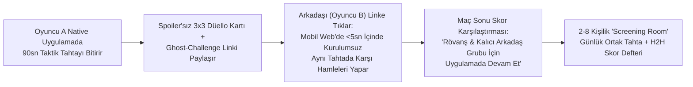

# STRATEJİK SAVAŞ KONSEYİ (6 BAKIŞ AÇISI + RED TEAM), KULLANILAN SKILL/REPO MİMARİSİ VE NİHAİ FARKLILAŞMA PLANI

> **Dosya Konumu:** `docs/strategy/02_WAR_COUNCIL_PERSPECTIVES_AND_DIFFERENTIATION_PLAN.md`  
> **Tamamlayıcı Pazar/Adli Analiz Dosyası:** `docs/strategy/01_COMPETITOR_FORENSICS_AND_LICENSING_TEARDOWN.md`  
> **Diğer Ajanlar İçin Hızlı Bağlam (Agent Handoff Prompt):**  
> *Bu projede herhangi bir özellik, veri hattı, UI veya backend değişikliği yapmadan önce `AGENTS.md`, `MASTER_SPECIFICATION_v3.md`, `docs/design/DESIGN.md`, `docs/architecture/DATA_GOVERNANCE.md` ve bu iki `docs/strategy/` belgesini oku. İsim/marka tartışması şu an kapsam dışıdır; odak noktamız ürünü mekanik, UX, içerik doğruluğu ve viral arkadaş döngüsüyle rakiplerin önüne geçirmektir. Bölüm 5'teki `DO NOT BUILD` listesindeki hiçbir özelliği inşa etme.*

---

## 1. ARAŞTIRILAN GITHUB REPOLARI VE PROJEYE KURULAN YETENEK (SKILL) MİMARİSİ

Pazar ve strateji analizini tek bir yapay zekânın yüzeysel ve uyumlu (*sycophantic*) yanıtlarına bırakmamak için GitHub üzerindeki açık kaynak ajan/konsey mimarileri incelenmiş, gerçek depolar doğrulanmış ve projemizin `.agents/skills/` dizinine kalıcı araçlar olarak kurulmuştur:

### 1.1 İncelenen Kaynak Repolar ve Neyi Nasıl Aldığımız
1. **`Jakeschincariol/replica-skill` (10.620★):** 11 aşamalı *clean-room* ürün klonlama ve farklılaştırma metodolojisi (`recon → diff → entrepreneur → launch`). Özellikle rakibin telifli verisini değil **kullanıcı akışını** çözme ve gerçek mağaza yorumlarından **kullanıcı nefreti madenciliği (`/replica-entrepreneur`)** yapma disiplini alındı.
2. **`affaan-m/everything-claude-code` (`ECC`, 6.852★+):** Antropik hackathon kazananı tam kapsamlı ajan yapılandırması (`agents/`, `skills/`, `hooks/`, `rules/` ve `contexts/`). Buradaki **meşru dinamik bağlam enjeksiyonu (`contexts/research.md`, progressive disclosure)** mimarisi incelendi; aynı zamanda açık kaynak `SKILL.md` ekosistemindeki **`SKILL-INJECT` / `ToxicSkills` tedarik zinciri istem enjeksiyonu** riskine karşı yerel tarayıcı yazıldı.
3. **`karpathy/llm-council` (26.970★) & `aiwithremy/claude-skills-llm-council` (3.272★):** Farklı danışmanların birbirinden habersiz ilk görüş üretmesi ve **2. aşamada isimler gizlenerek (`Advisor_1..6`) kör akran değerlendirmesi** yapılması mimarisi alındı.
4. **`evoputa/ai-advisory-board` (109 İş Lideri, 18 Alan):** Dalkavukluk karşıtı (*anti-sycophancy*) yönetim kurulu protokolü — tavsiye vermeden önce **stratejik gerilimi (tradeoff)** adlandırma ve zıt bakış açılarını çarpıştırma kuralı alındı.
5. **`shawnpang/startup-founder-skills` (396★), `borghei/Claude-Skills` (1.211★), `SuperShary/claude-council`:** Birim ekonomisi, pazar büyüklüğü doğrulaması ve Red Team ön-otopsi (*pre-mortem*) şablonları sentezlendi.

### 1.2 Projede Aktif Olan 3 Yerel Stüdyo Yeteneği (`.agents/skills/`)
Başka ajanlar veya oturumlar doğrudan şu yerel yetenekleri ve Python betiklerini çalıştırabilir:
- `.agents/skills/replica-competitor-intel/SKILL.md` → `python3 .agents/skills/replica-competitor-intel/scripts/listing_and_parity_audit.py`
- `.agents/skills/adversarial-war-council/SKILL.md` → `run_workflow` üzerinde 4 aşamalı kör çapraz sorgulu strateji konseyi protokolü.
- `.agents/skills/cine-ip-and-skill-guard/SKILL.md` → `python3 .agents/skills/cine-ip-and-skill-guard/scripts/ip_and_skill_scanner.py` (`src/` altında TMDB/IMDb/OMDb sızıntısını ve `.agents/skills/` altında `SKILL-INJECT` zararlı istem kalıplarını tarar — mevcut sonuç: **0 ihlal**).

---

## 2. ALTISI BİRBİRİNDEN İZOLE 6 STRATEJİK BAKIŞ AÇISI (TAM KONSEY ANALİZİ)

Aşağıdaki 6 analitik mercek, kod tabanımızın gerçek metriklerini (721 yapım: 544 film + 177 dizi; 2023–2026 arası sadece 10 yapım; 203 adet ≥3 ortak oyunculu film çifti; `REVERSE_CAST` 2 statik tahta; `CINE_CONCEPT` 5 statik tahta; `SHOW_ONLINE_ROOM=false`; sunucu doğrulaması eksik `submit_move` RPC) ve tüm rakip verilerini birbirini görmeden paralel olarak denetlemiştir:

### Mercek 1 — İlk İlkeler ve Hız Merceği (*Musk Çerçevesi*)
- **Teşhis:** "Şu anki en büyük tehlike sahte ilerleme hissidir: elle 721 filmi 2.500 filme çıkarmaya çalışmak doğrusal bir angarya bandıdır ve bittiğinde bile TMDB kullanan herhangi bir web sitesinin binde biri kadar kalır. Üstelik açık metin kutusu durduğu sürece 2.500 filmde de oyuncu bildiği geçerli bir filmi yazdığında sistem reddedecek (*Sportrix* sendromu)."
- **Yıktığı Yanılsama:** Manuel statik film kürasyonu bir rekabet üstünlüğü değildir; prosedürel üretimi kapalı tutarken (`generateSolvableBoard` sadece `CLASSIC` üretiyor) statik JSON büyütmek mühendislik israfıdır.
- **Önerdiği Kaldıraç:** **(1)** Ceza fiziğini değiştir: İndekste olmayan film asla sıra yakmasın; **(2)** Manuel veri girişini sıfırla, 2023–2026 eksiklerini CC0 Wikidata SPARQL hattıyla otomatik kapat ve halihazırda veritabanında duran **203 ortak oyunculu film çiftini** prosedürel `REVERSE_CAST` motoruna bağlayarak tek satır veri eklemeden yüzlerce yeni tahta üret.

### Mercek 2 — Ürün Basitliği, İlk 30 Saniye ve Ritüel Merceği (*Jobs Çerçevesi*)
- **Teşhis:** "35mm karanlık oda estetiği güçlü bir ruh veriyor, ama ilk 30 saniyede oyuncunun karşısına çıkan deneyim acımasız bir **ezber sınavı**: mobil klavyede küçücük tuşlarla yabancı yönetmen/film adı yazmaya çalışırken yukarıda şut saati geriye sayıyor. *Callback*'in yaptığı en zeki şey şuydu: boş arama kutusunu kaldırıp oyuncunun önüne dokunulabilir bir `Film Bank` koydu ve bilişsel yükü 'hatırlama paniği'nden 'bulmaca çözme hazzı'na kaydırdı."
- **Yıktığı Yanılsama:** *"Boş arama kutusu + şut saati = gerçek sinefil yeteneği"* varsayımı mobilde kitleyi ilk dakikada eler. Ayrıca henüz çok oyunculu mod kapalıyken 11 farklı Elo botu + kariyer defteri + yarım kalan `CINE_CONCEPT` (5 tahta) sekmelerini vitrine dizmek odak kaybıdır.
- **Önerdiği Kaldıraç:** Prosedürel olmayan yarım modları (`CINE_CONCEPT`) ana menüden gizle; hızlı 1v1 düellolarda her iki oyuncunun gördüğü **ortak `35mm Contact Sheet` (20–24 kartlık film/oyuncu havuzu)** sunarak oyunu ilk 10 saniyede herkesin akıcı oynayabildiği bir taktik düelloya çevir.

### Mercek 3 — Tekel Hendeği ve Kopyalanamazlık Merceği (*Thiel Çerçevesi*)
- **Teşhis:** "Rekabet kaybedenler içindir. Dürüst olalım: 3×3 sinema gridi bugün bir emtiadır (*Cinematrix, MovieGrid.io, MovieGrid.org, Callback, Actorle 2.0*). Yarın sabah *Callback* Android uygulaması çıkarsa veya *Actorle 2.0* mevcut `Groups` özelliğine XOX bloklama eklerse, bugünkü tek oyunculu ürünümüzün **sıfır geçiş maliyeti (switching cost)** vardır. Telifsiz (clean-room) veri yapımız bir tüketici hendeği değil, sadece hukuki sigortadır."
- **Yıktığı Yanılsama:** *"Türkiye'de Yeşilçam/yerel quiz ile tek olalım"* fikri tipik bir sahte tekel tuzağıdır: TR mağazasındaki tüm yerli film quiz uygulamalarının toplamı **34 oy** etmiştir; para etmeyen küçücük bir havuzun %100'üne sahip olmak sıfır değer üretir.
- **Önerdiği Kaldıraç:** Boş duran tek gerçek kategori **"Native Mobilde Asenkron Taktik 1v1 Sinema Düelloları ve Arkadaş Rekabet Grafiği"**dir (*"Sinemaseverler için Chess.com"*). İki arkadaşın birbirine karşı tuttuğu 40 maçlık kafa kafaya (Head-to-Head) skor defteri, Elo geçmişi ve grup ligi oluştuğunda, hiçbir rakibin tek kişilik 3×3 sekmesi bu sosyal grafiği koparamaz.

### Mercek 4 — Tutundurma Çarkı ve Operasyonel Mükemmellik Merceği (*Bezos Çerçevesi*)
- **Teşhis:** "3 yıl sonra da değişmeyecek 4 oyuncu beklentisinden geriye doğru çalışalım: **(1)** Uygulamayı açtığımda 5 saniyede maça girmeliyim (boş lobi beklememeliyim), **(2)** Doğru bildiğim bir film asla yüzüme 'Yanlış' diye çarpmamalı, **(3)** 60 saniyelik tur bittiğinde araya reklam girmemeli, **(4)** Bugün çözdüğüm oyun yarınki serimi ve rekabetimi beslemeli. Bugün bizim veritabanımızda 2023–2026 arasından sadece **10 yapım** var; 2026 yılında sinema oyunu indirip *Dune: Part Two*, *Anora*, *Challengers* veya *Sinners* yazamayan oyuncu *Sportrix* yorumlarındaki gibi anında uygulamayı siler."
- **Yıktığı Yanılsama:** Uygulama paketi içine gömülü statik veriyle canlı sinema kültürünü yakalayabileceğimiz yanılsaması.
- **Önerdiği Kaldıraç:** Haftalık/aylık doğrulanmış CC0 veri paketleri + kriter üretiminde **tamlık kilidi** (filmografisi %100 doğrulanmamış hiçbir aktör/yönetmen tahta başlığı olarak üretilemez).

### Mercek 5 — Birim Ekonomisi ve Sermaye Disiplini Merceği (*Buffett Çerçevesi*)
- **Teşhis:** "Mobil oyun mezarlığı, kullanıcı edinme maliyeti (CAC) yaşam boyu değerden (LTV) yüksek olan uygulamalarla doludur. *Guess the Movie* (12.541 oy) ve *Actorle 1.x* düşük LTV'yi geçiş reklamlarıyla kapatmaya çalıştı ve 1★ yorumlarla kullanıcı tutundurmayı (retention) imha etti. *Codenames* `$4.99` peşin fiyat koyabildi çünkü arkasında milyonlarca kutu satmış fiziksel bir masa oyunu markası var; bizim öyle bir markamız yok, peşin ücret organik indirmeyi bıçak gibi keser."
- **Yıktığı Yanılsama:** Pazarlama bütçesi harcayarak büyüme veya reklam göstererek para kazanma varsayımı.
- **Önerdiği Kaldıraç:** Sunucu maliyeti neredeyse **$0** olan (statik istemci + hafif Supabase RPC + çevrimdışı botlar), telif maliyeti **$0** olan (%100 clean-room), geçiş reklamı **$0** olan bir yapıda başabaş noktası çok düşüktür. Organik D7 tutundurma **≥%15** kanıtlanana kadar ücretli reklama **$0** harcanmalıdır.

### Mercek 6 — Viral Döngüler, Soğuk Başlangıç ve Kabile Merceği (*Hoffman + Godin Sentezi*)
- **Teşhis:** "Çok oyunculu mobil oyunların %95'i *CineQuizz*'in `'Serveurs vide'` (boş sunucular) tuzağında ölür; çünkü aynı saniyede aynı beceri seviyesinde iki yabancıyı eşleştirmek binlerce eşzamanlı aktif kullanıcı (CCU) ister. *Cine2Nerdle* bile web'de `%94.2` İngilizce Tier-1 trafiği ve yayıncı desteğiyle ayakta duruyor."
- **Yıktığı Yanılsama:** `SHOW_ONLINE_ROOM=true` yapıp genel eşleşme odası açmanın çok oyunculu modu çalıştıracağı yanılsaması.
- **Önerdiği Kaldıraç:** Eşleşmeyi yabancılar üzerinden değil, **mevcut arkadaş bağları (pre-existing social graph)** üzerinden kur: Letterboxd, Film Twitter ve Reddit (`r/MovieSuggestions`, `r/CINE2nerdle`, `r/Letterboxd`) kabilelerinde tek tıkla paylaşılan **Ghost-Challenge düello linkleri** ve 2–8 kişilik **kalıcı `Screening Room` arkadaş odaları**.

---

## 3. RED TEAM SAVCISININ YIKTIĞI 6 TEHLİKELİ İLLÜZYON VE KÖR HAKEM HÜKMÜ

Bağımsız **Red Team Savcısı**, yukarıdaki 6 danışmanın önerilerini bile acımasızca sorgulamış ve Kör Çapraz Sorgu Başhakemi şu düzeltmeleri nihai plana bağlamıştır:

1. **İllüzyon #1 — *"Sadece 12–24 kartlık Film Bank verirsek hem kolay olur hem derin kalır"*:**
   - *Red Team İtirazı:* Sadece kart seçtirirsek *Callback*'ten farkımız kalmaz ve sıkı sinefillerin "hafızadan nadir film bulup koyma" tatmini ölür.
   - *Nihai Çözüm:* İkisini aynı ekranda çorba yapma; **mod bazında ayır**: **1v1 Hızlı Taktik Düello** ortak `35mm Contact Sheet` (20–24 kartlık havuz) ile oynansın (sıfır klavye sürtünmesi, saf bloklama/çatal stratejisi); **Günlük Bulmaca & Klasik Sinefil Modu** ise indeksli otomatik tamamlama + `DATA_GOVERNANCE.md` içindeki nadirlik çarpanlarıyla (`Common → Legendary`, `answerCountMap`) hafıza ustalığını ödüllendirsin!
2. **İllüzyon #2 — *"Wikidata'dan 200 film çekmek 2 haftada her şeyi çözer"*:**
   - *Red Team İtirazı:* Ham Wikidata'da festival yılı ile vizyon yılı karışır, figüranlar başrol gibi listelenir ve *Sportrix*'ten beter hatalar doğar.
   - *Nihai Çözüm:* `DATA_GOVERNANCE.md` Bölüm 1.3'teki **alan bazlı provenance** kuralına sıkı sıkıya uyulacak: sadece resmi vizyon yılı, ilk 10 faturalı oyuncu (`billing order`), doğrulanmış yönetmen ve içeride **en az 6 doğrulanmış filmi** olan kriterler tahta üretimine girebilecek.
3. **İllüzyon #3 — *"Filmed Up gibi `$99.99` IAP satarız"*:**
   - *Red Team İtirazı:* *Filmed Up* canlı kart borsası (TCG) satıyor; bizim anayasamız (`AGENTS.md` #5) rekabet avantajı sağlayan satışı yasaklar.
   - *Nihai Çözüm:* Sahte `$99.99` hayalini çöpe at. Gerçekçi ve kanıtlanmış model (*Actorle Plus* `$2.99/ay` & *Callback* iOS-özel arşiv modeli): **`$2.99/ay` (`$19.99/yıl`) Vault & Supporter Pass** (tüm geçmiş günlük tahta arşivi, sınırsız özel *Screening Room* kuralları, detaylı kafa kafaya rekabet istatistikleri) + **`$1.99–$4.99` 35mm projektör/film şeridi kozmetikleri**.
4. **İllüzyon #4 — *"Mobil uygulama içinden davet linki atınca insanlar App Store'dan indirip oynar"*:**
   - *Red Team İtirazı:* Web rakipleri (*Actorle, CineNerdle, Cinematrix*) linke tıklandığı saniye Safari'de açıldığı için paylaşılıyor. Tıklayan kişiyi doğrudan App Store indirme duvarına çarptırırsak %85'i daha ilk maçı görmeden kaçar!
   - *Nihai Çözüm:* Projede zaten **Next.js 14 statik web çıktısı** mevcut! Paylaşılan düello linki (`?duel=...`), tıklayan arkadaşı **kurulumsuz mobil tarayıcıda 3 saniyede doğrudan o 3×3 tahtanın içine** sokacak; ilk düelloyu tarayıcıda oynayıp tadını aldıktan sonra *"Rövanşı başlat, serini koru ve arkadaş odasına katıl"* çağrısıyla iOS/Android uygulamasına indirecek!
5. **İllüzyon #5 — *"4 saniyede insan bulunamazsa botu insan gibi maça sokalım"*:**
   - *Red Team İtirazı:* Oyuncular botu gerçek insan gibi gizleyen oyunları fark ettikleri saniye 1★ *"Sahte multiplayer"* yorumu basar.
   - *Nihai Çözüm:* **%100 Şeffaflık.** Botlar zaten bizim güçlü yanımız (11 karakterli sinema personası ve kariyer defteri); her zaman şeffaf biçimde bot/sparring rakibi olarak etiketlenecek, asla sahte insan kılığına sokulmayacak.
6. **İllüzyon #6 — *"45 günde 7 devasa özelliği aynı anda çıkaralım"*:**
   - *Red Team İtirazı:* Yarım yamalak çok özellik, mevcut `REVERSE_CAST` (2 tahta) ve `CINE_CONCEPT` (5 tahta) gibi içi boş vitrinler yaratır.
   - *Nihai Çözüm:* Önce mevcut 721 yapımdaki gizli gücü aç, `CINE_CONCEPT`'i gizle, sunucu RPC'sini sağlamlaştır ve tek bir kusursuz sosyal döngü çıkar.

---

## 4. BU UYGULAMA NASIL FARKLILAŞACAK VE RAKİPLERİNİ NASIL GEÇECEK? (SOMUT ÜRÜN DENKLEMİ)

Rakiplerin hiçbirini "daha fazla çoktan seçmeli soru yazarak" geçmeyeceğiz. Rakipleri **oyun fiziğini değiştirerek** geçeceğiz:

### 4.1 Kategori Farkı: "Tek Kişilik Bulmaca" Değil, "90 Saniyelik Alan Savunması ve Çatal Kurma"
- *Cinematrix*, *MovieGrid* ve *Callback*'te 9 kutuyu doldurursun, kimse yolunu kesmez.
- Bizde merkez kareyi (`[1,1]`) almak aynı anda 4 kazanma çizgisini (yatay, dikey, iki çapraz) tehdit eder. Rakibin iki farklı karede kazanma tehdidi (çatal / *fork*) kurduğunda, ya onun kesişimini kapatacak filmi bulursun ya da ikinizin de bilemediği bir kesişim **`LOCKED_NEUTRAL`** olarak mühürlenip tahtanın geometrisini kalıcı olarak değiştirir; kilitlenen tahtalarda **`GOLDEN_REEL`** düğümü çözer.
- **Sonuç:** *Cine2Nerdle*'ın 8 dakika 15 saniyelik rekabetçi bağımlılığını, **90–120 saniyelik mobil mola süresine** ve herkesin anında anladığı **3×3 XOX tahtasına** indirgiyoruz.

### 4.2 İçerik Kaldıracı: Sıfır Manuel Girişle 2 Tahtadan Yüzlerce Tahtaya Geçiş
Mevcut kod tabanı denetimimiz çok çarpıcı bir gerçeği ortaya çıkardı:
- `MOVIES_DATABASE` içindeki 721 yapımda halihazırda **en az 3 ortak oyuncusu bulunan 203 film çifti** var, fakat `REVERSE_CAST` modu elle yazılmış **2 statik tahtaya** mahkûm bırakılmış ve `src/core/engine/` içindeki `generateSolvableBoard` yalnızca `CLASSIC` tahta üretiyor!
- Yalnızca `generateSolvableBoard`'u mevcut 203 film çifti üzerinden prosedürel `REVERSE_CAST` üretecek şekilde genişlettiğimizde ve 2023–2026 arasından 150–250 popüler filmi doğrulama kapılı CC0 Wikidata hattıyla eklediğimizde, **tek bir manuel Excel satırı yazmadan** binlerce benzersiz, güncel ve çözülebilir taktik tahta elde ediyoruz.

### 4.3 Büyüme Motoru: "Kurulumsuz Web İlk Hamle → Native Arkadaş Odası (`Screening Room`)"

Bu döngü aynı anda üç rakip zayıflığını vurur:
1. *CineQuizz*'in boş sunucu problemini sıfırlar (eşleşme kendi arkadaş linkinle başlar).
2. Mobil uygulamaların App Store indirme duvarı sürtünmesini kırar (arkadaşın kurulum yapmadan ilk maçı tarayıcıda oynar).
3. *Callback*'in web'den iOS'a geçiş kancasını (arşiv + seri + grup geçmişini native uygulamada tutma) rekabetçi düelloyla birleştirir.

---

## 5. KESİN "BUNLARI YAPMA" LİSTESİ (`DO NOT BUILD / KILL LIST`)

Projede çalışan hiçbir geliştirici veya ajan şu maddelere zaman harcamamalıdır:
1. **Manuel 2.500 statik film veritabanı yazma angaryası** (bunun yerine prosedürel `REVERSE_CAST` + doğrulama kapılı 150–250 güncel film CC0 betiği).
2. **Lansmanda herkese açık rastgele eşzamanlı 1v1 eşleşme kuyruğu** (`Serveurs vide` mezarlığı; yalnızca arkadaş davet linki + asenkron düello + şeffaf çevrimdışı bot).
3. **Veritabanında olmayan gerçek bir filmi "Yanlış" sayıp oyuncunun sırasını yakan açık arama cezası.**
4. **Prosedürel üretime bağlanmadan ana ekranda tutulan 5 tahtalık `CINE_CONCEPT` modu** (prosedürel olana kadar gizlenmeli).
5. **Maç aralarına konacak her türlü geçiş/video/banner reklamı** (*Guess the Movie* ve *Actorle 1.x* çöküş sebebi).
6. **TMDB API, `image.tmdb.org` poster CDN'i, IMDb `.tsv`/puan verisi veya telifli film kareleri** (`DATA_GOVERNANCE.md` ve clean-room zırhını deler).
7. **Türkiye-öncelikli / Yeşilçam-merkezli birincil büyüme stratejisi** (TR mağaza tavanı globalin <%1'idir; Türkçe dil desteği korunurken ana hedef kitle ABD/UK/CA/AU İngilizce sinefil kabilesidir).
8. **5–10 mini oyunlu paket klonlaması veya P2W kart/gacha ekonomisi.**

---

## 6. MEVCUT KOD TABANINA DOĞRUDAN UYGULANABİLİR ÖNCELİKLİ YOL HARİTASI

*(Not: İsim/marka değişikliği kurucu kararıyla şu an kapsam dışı bırakılmıştır; aşağıdaki adımlar doğrudan ürün, motor, veri ve büyüme katmanlarını çalıştırır.)*

### Adım 1 — Oyun Motoru ve Çok Oyunculu Güvenlik Kilidi (`src/core/engine/` & `supabase/`)
- **Mevcut Durum:** `src/config/flags.ts` içinde `SHOW_ONLINE_ROOM = false`. `supabase/migrations/20261101_faz4_submit_move_rpc.sql` sunucu tarafında filmin satır/sütun kriterini sağlayıp sağlamadığını kontrol etmiyor, eski `p_is_stealing` parametresini taşıyor ve `LOCKED_NEUTRAL`, `REVERSE_CAST`, `GOLDEN_REEL` kurallarını içermiyor.
- **Yapılacak İş:**
  1. Sunucu tarafı `submit_move` doğrulamasını `MASTER_SPECIFICATION_v3.md` ile bire bir eşitle (`p_is_stealing` kaldırılacak, kriter kesişimi sunucuda doğrulanacak, `LOCKED_NEUTRAL` ve `GOLDEN_REEL` işlenecek).
  2. `generateSolvableBoard` fonksiyonunu mevcut **203 ortak oyunculu film çiftini** kullanarak prosedürel `REVERSE_CAST` tahtaları üretecek şekilde genişlet; 5 statik tahtalı `CINE_CONCEPT` modunu prosedürel üretici yazılana dek menüden gizle.

### Adım 2 — Sıfır-Öfke Giriş Deneyimi ve 2023–2026 Güncellik Yaması (`src/features/gameplay/` & `src/data/`)
- **Yapılacak İş:**
  1. **1v1 Taktik Düello Modu için `35mm Contact Sheet` (20–24 Kartlık Seçim Havuzu):** Tahtadaki 9 hücrenin geçerli kesişimlerini ve taktik yanıltıcıları içeren ortak kart destesi arayüzünü (`DESIGN.md` 35mm kontakt baskı estetiğine sadık kalarak, `XoxBoard.tsx` ve `ShotClock.tsx`'e dokunmadan!) ekle.
  2. **Günlük / Klasik Arama Koruması:** İndekste bulunmayan aramalarda sıra yakmayan net bildirim + Film (`544`) ve Dizi (`177`) ayrım filtresi.
  3. **Doğrulama Kapılı CC0 Wikidata Betiği:** `DATA_GOVERNANCE.md` alan bazlı provenance şemasına uygun olarak 2023–2026 döneminden **150–250 yüksek bilinirlikli filmi** (resmi yıl, ilk 10 başrol, doğrulanmış yönetmen, ≥6 film kriter eşiği) veri setine ekle.

### Adım 3 — Kurulumsuz Mobil-Web Ghost-Duel ve Kalıcı `Screening Room` (`src/features/multiplayer/`)
- **Yapılacak İş:**
  1. Paylaşılan düello bağlantısını (`?challenge=...`) tıklayan kişinin uygulama indirmeden mobil tarayıcıda anında oynayabileceği hafif Ghost-Duel akışını aç.
  2. 2–8 arkadaşın günlük ortak tahtada yarıştığı ve kendi aralarındaki 1v1 galibiyet/mağlubiyet defterini tuttuğu kalıcı **`Screening Room`** grup yapısını devreye al (`SHOW_ONLINE_ROOM = true` yalnızca arkadaş linki ve grup düelloları için açılacak; rastgele boş lobi kuyruğu açılmayacak).

### Adım 4 — Metrik Doğrulama ve Gelir Katmanı (`Vault & Supporter Pass`)
- **Geçiş Kapısı (Validation Gate):** Organik Tier-1 İngilizce testinde **D1 ≥ %35**, **D7 ≥ %15** (arkadaş gruplarında **≥ %22**), **Katalog yanlış-ret şikâyeti < %1** ve **Davet linki dönüşümü K ≥ 0.30** görüldüğünde `$2.99/ay` (`$19.99/yıl`) **Vault Pass** (tam geçmiş günlük arşiv + özel oda kuralları + detaylı H2H analizleri) ve `$1.99–$4.99` 35mm kozmetik temaları aç.
